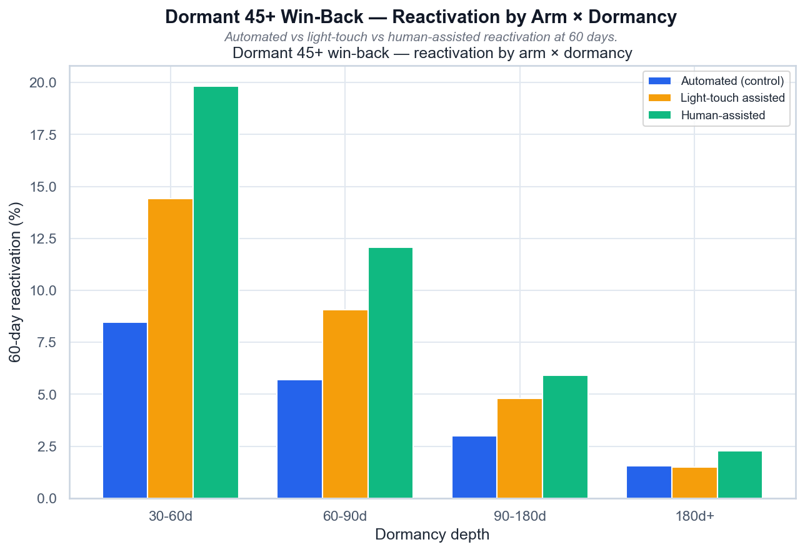

# Volta — Dormant 45+ Win-back

[](https://github.com/NikitaBoyarkin/case-dormant-winback/actions/workflows/ci.yml)

[](LICENSE)

Three-arm win-back: human +5.34pp and light-touch +2.77pp vs control. Light-touch pays off at 30–90d (ROI 2.54 / 1.26), human ROI 0.40 — kill as a mass channel.

## Key results

- human +5.34pp, light-touch +2.77pp
- Light-touch ROI 2.54 (30–60d) and 1.26 (60–90d)
- human ROI 0.40 — doesn't pay back

## Situation

The last RAT v2 project: Project 13 argued that 45+ dormancy is a UX barrier. We test whether assisted reactivation recovers these dormant users and whether it pays off.

## Task

I owned the closing check of the validation round: whether assisted reactivation actually brings dormant senior users back, and whether that effort pays for itself.

## Actions

- Three-arm randomized win-back: automated / light-touch / human.
- Four dormancy buckets; z-tests by arm and bucket with Holm correction.
- ROI per 10K treated, targeting boundary, break-even LTV.

## Result

- Mechanism confirmed: **human +5.34pp** and **light-touch +2.77pp** vs control (both significant); strongest at 30–60d (human **+11.37pp**).
- Economics refine it: light-touch pays off at **30–60d (ROI 2.54)** and **60–90d (1.26)**; human loses money everywhere (**overall 0.40**).
- At 180d+ the effect nearly vanishes.

## Recommendations

- Launch light-touch win-back targeting **30–90 day** dormant users (ship narrowly).
- Human calls are an escalation for high-value/high-balance, not a mass channel (kill).
- Don't touch 180d+ — the economics are negative.

## Charts



> # Dormant 45+ Win-Back — Reactivation by Arm × Dormancy
>
> 
>
> *Реактивация (60 дней) по arm × глубине дормантности: автоматический vs light-touch vs human.*
>
> ## Выводы
>
> - Assisted-реактивация: human даёт +11.4 п.п. (p=0.00e+00) на 30–60 днях против control.
> - Эффект падает с глубиной дормантности: на 180d+ +0.7 п.п. против +11.4 п.п. на 30–60d.
> - Light-touch даёт 52% эффекта human (overall) за долю цены.
> - Дормантность 45+ — реально UX-барьер: у человека+упрощённого флоу возврат растёт.
>
> ---
> <sub>Источник: `scripts/volta_dormant_winback.py` · данные: `data/volta_dormant_winback.csv`</sub>


> # Dormant 45+ Win-Back — ROI by Arm × Dormancy
>
> 
>
> *ROI (восстановленный LTV / прирост затрат) по arm × глубине дормантности; ROI=1 — окупаемость.*
>
> ## Выводы
>
> - Human-звонок не окупается ни на одной глубине (max ROI 0.92 < 1) — €11 на юзера слишком дорого.
> - Light-touch окупается на: 30-60d (ROI 2.54), 60-90d (ROI 1.26); на остальных глубинах — нет.
> - Целевой трек: light-touch только на 30-60d, 60-90d; глубже — не тратить.
> - Human — только как эскалация для high-value/high-balance юзеров.
>
> ---
> <sub>Источник: `scripts/volta_dormant_winback.py` · данные: `data/volta_dormant_winback.csv`</sub>

## Dataset

The dataset is fully synthetic, generated by seeded, reproducible script(s) (`scripts/generate_dormant_winback_data.py`). No real customer data is used. Running `make data` regenerates the CSV(s) in `data/` with the same random seed, so every number below is reproducible.

## Quick start

```bash
uv sync --all-groups
make data
make run
```

## Project structure

```text
case-dormant-winback/
├── README.md
├── LICENSE
├── .gitignore
├── .python-version
├── pyproject.toml
├── Makefile
├── .github/workflows/ci.yml
├── scripts/
│   ├── generate_dormant_winback_data.py
│   └── volta_dormant_winback.py
├── utils/
│   ├── __init__.py
│   ├── common.py
│   └── viz_helpers.py
├── data/
│   └── volta_dormant_winback.csv
├── outputs/
│   ├── dormant_winback_reactivation.png
│   ├── dormant_winback_roi.png
└── tests/
    └── test_dormant_winback.py
```

## Stack

- Python
- pandas / NumPy
- SciPy / Statsmodels
- scikit-learn
- Matplotlib / Seaborn
- uv + ruff

## Links

- [Full case study on the portfolio site](https://nikitaboyarkin.github.io/en/projects/volta/dormant-winback/)
- [Parent project — volta-banking](https://github.com/NikitaBoyarkin/volta-banking)
